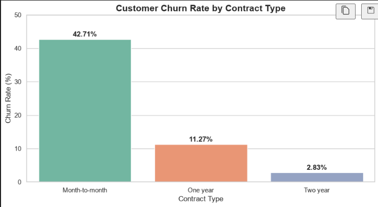
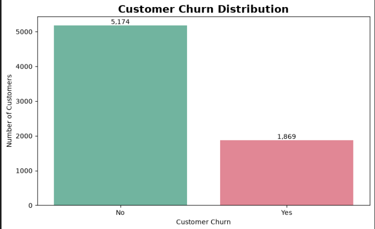
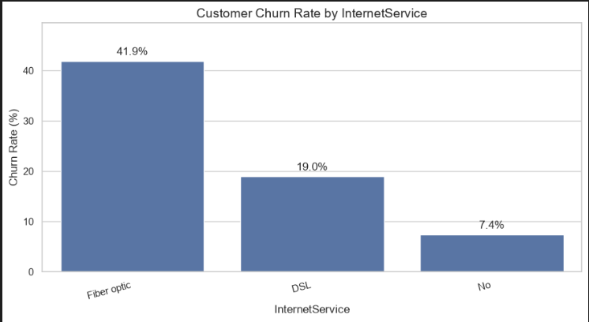

# ChurnScope 📊
### Customer Churn & Retention Analysis

**ChurnScope** is a Python-based data analytics project that explores customer churn patterns in a telecommunications dataset. The goal is to identify customer groups with higher churn rates and turn the findings into actionable retention strategies.

## 🎯 Project Objectives

- Analyze customer churn and retention rates.
- Identify patterns across contract types, internet services, and payment methods.
- Explore how customer tenure and monthly charges relate to churn.
- Develop data-driven recommendations for customer retention.

## 🛠️ Tools & Technologies

- **Python** — data analysis
- **Pandas & NumPy** — data manipulation
- **Matplotlib & Seaborn** — data visualization
- **Jupyter Notebook** — exploratory data analysis

## 📂 Project Structure

```text
ChurnScope/
├── notebooks/
│   └── 01_exploration.ipynb
├── README.md
├── PROJECT_FINDINGS.md
├── requirements.txt
└── .gitignore
```

## 📈 Key Findings

Analysis of 7,043 telecommunications customers revealed:

- **26.54% overall churn rate** across the dataset.
- **42.71% churn rate** among month-to-month contract customers.
- **2.83% churn rate** among two-year contract customers.
- **41.89% churn rate** among fiber-optic internet customers.
- **45.29% churn rate** among electronic-check users.
- Customers who churned had a median tenure of **10 months**, compared with **38 months** for retained customers.
  
  ## 📊 Visual Analysis

### Customer Churn Rate by Contract Type



### Customer Churn Distribution



### Churn Rate by Internet Service



## 💡 Business Recommendations

1. Encourage month-to-month customers to explore longer-term plans.
2. Investigate customer satisfaction and service issues among fiber-optic users.
3. Review the payment experience for electronic-check users and offer convenient alternatives.
4. Focus retention efforts on customers in their early months.
5. Investigate whether technical support and online security offerings could improve customer retention.

## 🚀 How to Run

1. Clone or download this repository.
2. Install the dependencies:

   ```bash
   pip install -r requirements.txt
   ```

3. Download the Telco Customer Churn dataset and place the CSV file at:

   `data/raw/Telco-Customer-Churn.csv`

4. Open `notebooks/01_exploration.ipynb` in Jupyter Notebook or VS Code and run the cells.

**Dataset note:** The raw dataset is not included in this repository.

## 👤 Author

Created as a data analytics portfolio project to demonstrate Python-based exploratory data analysis, data cleaning, visualization, and business insight generation.
